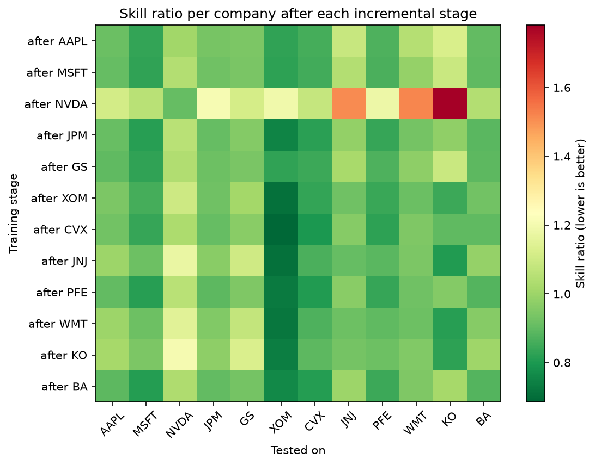

# LSTM Continual Learning on Stocks

Ryan O'Neil — Rco220002

**Does one model trained across many stocks beat learning them one at a time?**

A Long Short-Term Memory network written by hand in NumPy and used to predict
next-day movement for 12 S&P 500 companies. No deep learning libraries are
used anywhere. The cell, the forward pass, backpropagation through time and
the training loop are all implemented directly.

The project compares two ways of training on many related time series:

- **Pooled:** one model trained on all 12 companies at once
- **Sequential (continual):** one model trained on one company per stage,
  warm-started through all 12 stages and never reset, then tested on every
  company after every stage to measure forgetting

## Key results

Skill is the model's RMSE divided by the RMSE of a baseline that always
predicts the training-set mean of the target. **Below 1.0 beats the baseline**,
1.0 means no improvement, above 1.0 is worse.

**Pooled vs sequential (next-day volatility)**

| Model | Skill |
|---|---|
| Pooled, all 12 companies at once | **0.8691** |
| Sequential, after all 12 stages | 0.9036 |
| Sequential, right after the NVDA stage | 1.2258 |

- The pooled model wins, but only when the data is pooled rather than
  presented in sequence.
- Training on NVDA, the most volatile stock, made the model worse than the
  baseline on the calmest stocks (KO 1.78, WMT 1.52, JNJ 1.51). The model
  calibrates its output *scale* to whatever it trained on most recently.
- The damage is temporary. Skill recovers by the next stage, and AAPL ends
  slightly *better* than right after its own stage (forgetting −0.0192).
  This is recency bias in the output scale, not catastrophic forgetting.



**Volatility vs returns (same model, same data, same hyperparameters)**

| Target | Skill | R² |
|---|---|---|
| Next-day returns | 1.0002 | −0.003 |
| Next-day volatility | 0.8691 | 0.2326 |

Returns are not predictable from these features, so no stock-specific
knowledge is learned and there is nothing to forget. Volatility is.

## Project structure

```
├── src/
│   ├── lstm.py             the algorithm, all of it by hand
│   │                       sigmoid, parameters, lstm_step, forward, backward, train
│   ├── data.py             download, caching, features, chronological split,
│   │                       scaling and windowing
│   ├── main.py             config, the 11-run hyperparameter sweep, the
│   │                       incremental experiment, evaluation and figures
│   └── test_gradients.py   numerical gradient check
├── figures/                plots written by main.py
├── results/
│   ├── log.txt             every experiment as a numbered block with its
│   │                       full config and results
│   └── log_old_format.txt  early runs in the original log format
├── docs/
│   └── Project_Status_Report.pdf
└── requirements.txt
```

## Setup

Python 3.9 or newer.

    pip install -r requirements.txt

numpy, pandas, matplotlib, requests.

## Running it

From the repo root:

    python src/main.py

The first run needs internet. It downloads 12 CSVs from
[RyanONeilCS/MachineLearningProjectData](https://github.com/RyanONeilCS/MachineLearningProjectData)
and caches them in `data_cache/`. Every run after that reads the cache and
needs no network.

A full run takes a few minutes. The hyperparameter sweep is fast; the
incremental experiment is the slow part.

Each run appends to `results/log.txt` and writes four figures to `figures/`:

| Figure | Shows |
|---|---|
| `loss_curve.png` | training loss for the base run |
| `sweep_skill.png` | skill of every hyperparameter setting |
| `forgetting_matrix.png` | skill per company after each incremental stage |
| `skill_vs_stages.png` | skill as companies are added one at a time |

## Checking the gradients

    python src/test_gradients.py

Compares every analytical gradient from the backward pass against a central
finite-difference estimate. Expected output ends with

    WORST 3.255e-07 -> PASS

## Switching the target

The target is set in one place, at the top of `src/data.py`:

    TARGET = "daily_range"     # tomorrow's volatility
    TARGET = "daily_return"    # tomorrow's price move

`main.py` reads `data.TARGET` into its config, so the experiment log can never
disagree with what the code actually did. Change that one line and rerun to
reproduce the returns vs volatility comparison.
